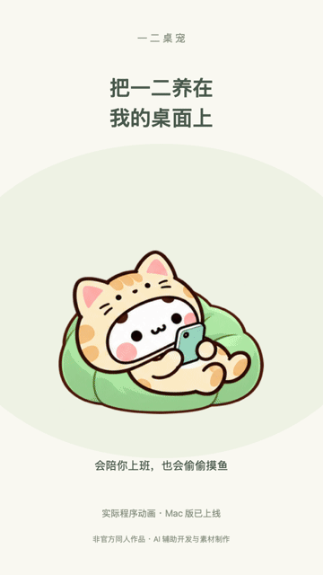
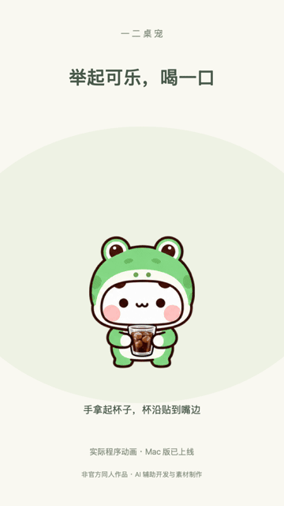
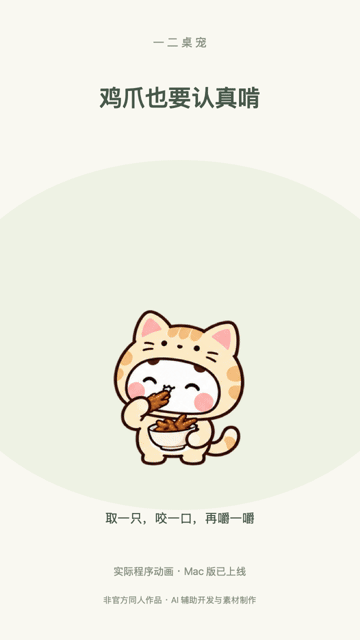

# Yier Desktop Pet

让一二或布布住在你的桌面上。可以拖动、随机换装、点击说话，右键打开小屋，通过家具吃饭、洗澡、工作、做饭、看电视、睡觉和找布布玩。

## 下载

[下载安装包](https://github.com/liruirui321/yier-desktop-pet-releases/releases/latest)

目前稳定版支持 Apple Silicon（M 系列）Mac，macOS 13 或更新版本。解压 `YierDesktopPet-macOS-arm64.zip`，把「Yier Desktop Pet.app」拖入应用程序后打开。当前采用本地签名，尚未 Apple 公证；如被系统拦截，请从系统设置的「隐私与安全性」允许打开，无需关闭系统安全功能。

Windows x64 预览版请下载 `YierDesktopPet-win-Setup.exe`，双击安装。已通过 Windows CI 渲染、安装和应用内升级测试；真实设备的多屏与缩放适配仍需进一步验证。安装包尚未进行发行者签名。目标受阻提醒目前提供本地提醒文件接口，未附带 Windows 自动监听程序。

- [Mac 直接下载](https://github.com/liruirui321/yier-desktop-pet-releases/releases/download/v0.5.1/YierDesktopPet-macOS-arm64.zip)
- [Windows 直接下载](https://github.com/liruirui321/yier-desktop-pet-releases/releases/download/v0.5.0/YierDesktopPet-win-Setup.exe)

当前为 Version 2：首次启动选择一二或布布，之后可在「设置 → 桌宠角色」切换，各自保留衣服与状态。v0.5.1 新增每小时休息提醒：白天累计陪伴一小时后，一二和布布放下手机一起伸个懒腰（20 秒无声动画），可在设置中关闭。v0.5.0 新增 24 套透明动态状态：11 套布布、7 套一二、6 套双人情景；两只熊各有 130 条情境语音。布布已去掉公主裙、女仆装和花仙子装。最小尺寸已支持 35%。

## 操作

- 拖动小熊：移动位置，允许部分移出屏幕。
- 单击小熊：播放当前情境语音。
- 双击小熊：随机换服装或动态状态，避免重复当前状态。六种双人情景不受所选主角色限制。
- 右键小熊：打开小屋，点击家具开始互动，小屋随即隐藏。
- 菜单栏小熊爪：设置、隐藏、回到中央和退出。

日常互动离线运行。v0.3.0 起可在「设置 → 检查更新」里直接下载、验证并安装新版，完成后重新打开；可关闭每天一次的自动检查。v0.2.2 及更早版本需要先手动安装一次新版。

设置中的「布布唤醒 / 一二唤醒」可独立关闭目标受阻/待回复提醒，关闭后不出现伙伴提醒动画和语音。开启时，夜间安静仍在 00:00–08:00 生效。普通找布布玩不受影响。目标受阻提醒需要额外接入本地提醒桥接，普通安装不会读取你的 AI 会话。

## 使用意见与问题

[提交问题或建议](https://github.com/liruirui321/yier-desktop-pet-releases/issues/new/choose)。需要登录 GitHub；请勿公开个人信息、令牌或私人文件。

本仓库只提供安装包、使用说明和反馈入口，不包含应用源代码。Release 页面自动生成的 Source code 压缩包仅含本仓库说明文件，请下载命名为 YierDesktopPet 的应用安装包。

非官方同人项目；角色与音色等素材权利归相应权利人。使用 AI 辅助开发与制作动画素材。

